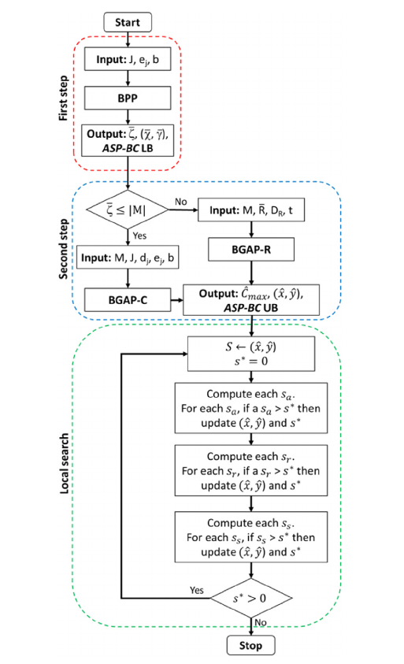

# AOCR

## **Progetto - ABGA**

### Dati

$N$   items, $m \in M$

$M$   unità, $n \in N$

$b$ capacità batteria

$p_{m,n}$  penalità

$q_{m,n}$  risorse richieste

$e_j$ dispendio energetico di un job $j$

$d_j$ tempo di erogazione di un job $j$

$R = \{1, …, n\}$ set di operazioni di ricarica

 $t$  tempo di caricamento batteria (costante)

$x_j^m \in \{0,1\}$ : uguale a 1 se il transfer job $j$ viene erogato da $m$

$q_j^m \in \{0,1\}$ : uguale a 1 se il charging job $r$ viene erogato da $m$

$y_{j,r}^m \in \{0,1\}$ : uguale a 1 se il transfer job $j$ dopo il charging job $r$ viene erogato da $m$

$C_{max} \in \Re^+$  : Tempo di completamento del processo di trasferimento

### Formulazione

$z = minC_{max}$

$C_{max} \ge \sum_{j\in J}d_j*x_j^m + \sum_{r \in R \backslash \{ 1\}} t*q_r^m  \ \ \  \forall \ m \in M$     :  Il tempo di completamento deve essere maggiore o uguale del tempo di erogazione dei job j eseguiti dalle unità m e il tempo di ricarica t per ogni ricarica eseguita da una unità m

$\sum_m x_j^m = 1 \ \forall \ j \in J$ : Ogni job può essere svolto solo da una unità

$\sum_r y_{j,r}^m = x_j^m  \ \ \forall j,m$   : la somma delle operazioni di ricarica associate ad un job ed una unità è uguale alla variabile binaria di transfer job erogato da tale unità

$2y_{j,r}^m \le x_j^m + q_r^m \ \ \forall j,r,m$ :   $y_{jr}^m$ può valere 1 solo se sia $x_j^m = 1$(il job j è assegnato all'AGV m) sia $q_r^m = 1$ (la ricarica r è assegnata allo stesso AGV m).

$q_r^m \le q_{r-1}^m \ \ \forall \ m,r \in R \backslash \{1 \}$ : symmetry breaking: le ricariche vanno "attivate" in ordine

 $q_1^m = 1 \ \forall \ m$ : ogni unità parte completamente carica

$\sum_{j \in J} e_j\, y_{jr}^m \le b \qquad \forall m \in M,\ r \in R$  : per ogni AGV $m$ e per ogni "blocco di ricarica" $r$, la somma dei consumi energetici $e_j$ di tutti i job eseguiti in quel blocco (cioè con $y_{jr}^m=1$) non può superare la capacità di batteria $b$. Senza questo vincolo il modello non avrebbe alcun legame con la batteria — sarebbe solo uno scheduling puro su macchine parallele.

### Suddivisione del problema

**STEP 1 - ASSEGNAZIONE TRANSFER JOB - RICARICHE**

$J, R$ rispettivamente set di job e di ricariche

$\gamma_r \in \{0,1\}$ : uguale a 1 se la r-esima ricarica viene erogata, altrimenti 0

$\chi_{r,j} \in \{0,1\}$ : uguale a 1 se il job j è assegnato alla r operazione di ricarica, altrimenti 0

$\zeta = min \sum_r \gamma_r$ : minimo della somma delle ricariche

$\sum_r \chi_{r,j}=1 \ \forall j$ : ogni job è assegnato ad una sola operazione di ricarica

$\sum_j e_j *\chi_{r,j} \le b*\gamma_r$ : se una ricarica viene usata, la somma dell’energia utilizzata da un transfer job è minore della capacità massima della batteria 

$\gamma_r \le \gamma_{r-1} \ \forall r \in R \backslash \{1\}$ : symmetry breaking: le ricariche vanno "attivate" in ordine

sia $\bar\zeta$ il valore ottimo dell’ultima iterazione eseguita dell’algoritmo, allora $max(0,\bar\zeta-|M|)$ è il minimo richiesto di ricariche da effettuare per tutti i job 

$Lower Bound \ (LB) = max \{\lceil \frac{[max(0,\bar\zeta-|M|)]*t+\sum_jd_j }{|M|}\rceil ,\lceil \frac{max(0,\bar\zeta-|M|)}{|M|}*t\rceil\}$ 

Il numeratore rappresenta il tempo totale minimo richiesta da tutti gli AGV per erogare tutti i trasferimenti ed eseguire le ricariche. Il secondo termine ci permette di considerare l’indivisibilità delle operazioni di ricarica.

Data la natura del problema, ci si aspetterebbe che la soluzione ottima utilizzi il minimo numero di ricariche, ma in realtà non è così.

**STEP 2 - ASSEGNAZIONE RICARICHE - AGV**

La soluzione dello scorso problema viene usata come input di questo

in particolare sia  $\bar\zeta$ la funzione obbiettivo ottimale del problema definito in precedenza

se $\bar\zeta \le |M|$  allora esiste una soluzione possibile che non include alcuna operazione di ricarica,

altrimenti, almeno un’operazione di ricarica è necessaria.

Per ogni casistica c’è un metodo per determinare una soluzione ammissibile:

**Soluzione senza operazioni di ricarica**

Questa casistica può verificarsi se il numero di job è relativamente piccolo rispetto agli AGV e/o i consumi sono relativamente bassi rispetto alla capacità della batteria

$z = min C_{max}$

$C_{max} \ge \sum_jd_j*x_j^m$ : Garantisce la coerenza della makespan e la durata dei transfer jobs

$\sum_mx_j^m =1$ : Tutti i transfer job sono stati eseguiti

$\sum_j e_j *x_j^m \le b$ :massimo consumo di energia per ogni AGV

**Soluzione con operazioni di ricarica**

In questo caso, sfruttiamo la soluzione del problema precedente BPP per settare un problema che assume che le operazioni di ricarica contengano le operazioni di trasferimento come oggetti e i veicoli come cestini (problema di tipo BGAP-R)

$(\bar\chi,\bar\gamma)$  Soluzione ottimale.

$\bar R$ il più piccolo subset di charging job in una soluzione ammissibile $(\bar R = \{ r \in R : \gamma_r = 1\})$

Ogni operazione di ricarica $\bar r \in \bar R$ ha una durata $D_{\bar r} = (\sum_j d_j * \bar\chi_{\bar r ,j})+t$ 

$z = min C_{max}$

$\theta_{\bar r,m}$ : variabile binaria, vale 1 se l’operazione di ricarica $\bar r$ è assegnata a *m*

$\sum_m\theta_{\bar r,m}= 1$ : garantisce che ogni operazione di ricarica sia associata ad un veicolo

$C_{max} \ge (\sum_{\bar r}D_{\bar r}*\theta_{\bar r, m}) -t$ : coerenza tra la durata del trasporto e ricarica dei veicoli

**STEP 3 - LOCAL SEARCH**

esplora un intorno di possibili soluzioni usando 3 mosse considerabili come add, swap e remove.

**add:** si crea una **nuova** operazione di ricarica su un altro AGV e vi si sposta un job; utile quando la soluzione ottima richiede **più ricariche** del minimo teorico.

sia $(\hat x, \hat y) , \hat C_{max}$ la soluzione ottenuta alla fine dello step 2 ed il corrispondente valore della funzione obiettivo

$\hat c_m = \sum_jd_j*\hat x_j^m + \sum_rt*\hat q_r^m$ : la durata del processo di trasferimento

$\hat J_m = \{ j \in J: \hat x_j^m =1\}$ : l’insieme dei job di trasferimento assegnati al veicolo m

$s_a(m_1,j,m_2)$ : risparmio ottenuto aggiungendo un job j da m1 a una nuova operazione di ricarica m2

$s_a(m_1,j,m_2) = max \{0,\hat C_{max}-max(\hat c_{m1} - d_j, \hat c_{m2}+d_j+t,\hat c_m)_{m \in M \backslash \{m1,m2\}}\}$

Si precisa che, se un job $j^*$è l’**unico** assegnato a un’operazione di ricarica $r^*$ dell’AGV $m^*_1$, allora la nuova durata del processo di trasferimento sull’AGV $m^*_1$ diventa $\hat{c}_{m^*_1} - d_j - t$.

**remove:** si sposta un job su una ricarica **già esistente** di un altro AGV, rispettando il vincolo di batteria; serve a sfruttare meglio le ricariche già pianificate.

$\hat R_m = \{r \in R: \hat q_r^m = 1\}$ : l’insieme delle operazioni di ricarica assegnate al veicolo m nella soluzione corrente

$\hat b_r^m = \sum_je_j \hat y_{jr}^m$ : energia richiesta dai job di trasferimento assegnati all’operazione di ricarica r del veicolo m

$s_r(m_1,j,m_2,r)$ : risparmio ottenuto rimuovendo un job j dal veicolo m1 e assegnandolo all’operazione di ricarica r del veicolo m2 senza superare la capacità della batteria $b-\hat b_r^m \ge e_j$

anche in questo caso, se un job $j^*$è l’**unico** assegnato a un’operazione di ricarica $r^*$ dell’AGV $m_1$allora la nuova durata del processo di trasferimento sull’AGV $m^*_1$ diventa $\hat{c}_{m^*_1} - d_j - t$.

**swap:** si scambiano due job tra due AGV (e due operazioni di ricarica), sempre rispettando i vincoli di batteria; serve a riequilibrare durate e carichi senza aggiungere ricariche.

$s_r(m_1,r_1,j_1,m_2,r_2,j_2)$ : risparmio ottenuto scambiando un job j1 dall’operazione di ricarica r1 del veicolo m1 con un job j2 dall’operazione di ricarica r2 del veicolo m2, senza superare la capacità della batteria $b−b^r_1m_1≥ej_2−ej_1 \ e \ b−b^r_2m_2≥ej_1−ej_2$

$s_r(m_1,r_1,j_1,m_2,r_2,j_2) = max \{0,\hat C_{max}-max(\hat c_{m1} - d_{j_1} + d_{j_2}, \hat c_{m2}+d_{j_1}-d_{j_2},\hat c_m)_{m \in M}\}$

### Dettagli di implementazione

Sia S la soluzione ottenuta alla fine del secondo step. La ricerca locale computa il massimo tra tre tipi di risparmio precedentemente descritti per ogni iterazione. 

Inizialmente poniamo il risparmio massimo $s^*=0$ , e computiamo add, remove e swap in ordine. ogni volta che si ottiene un risparmio maggiore di quello attuale, ne aggiorniamo il valore.

Finché $s^* > 0$ significa che è ancora possibile ridurre la makespan. Se $s^* \le 0$ allora ci si ferma.

